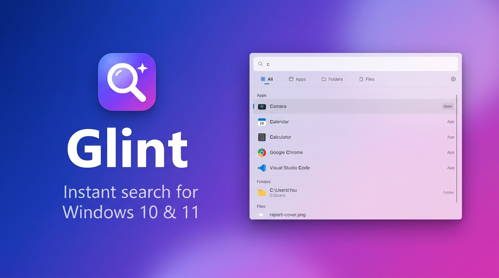
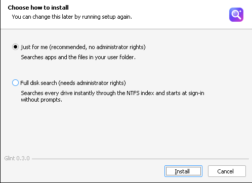
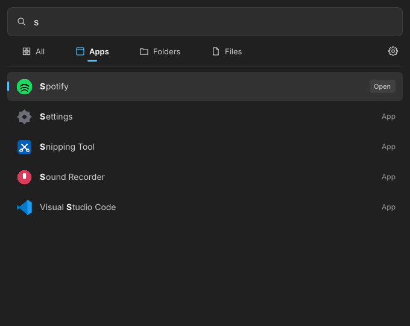
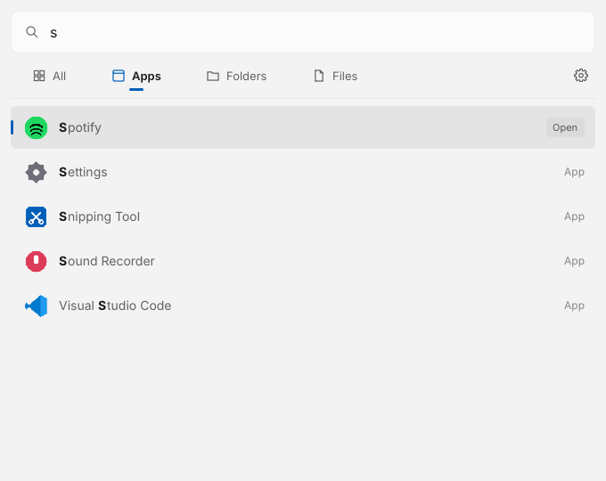
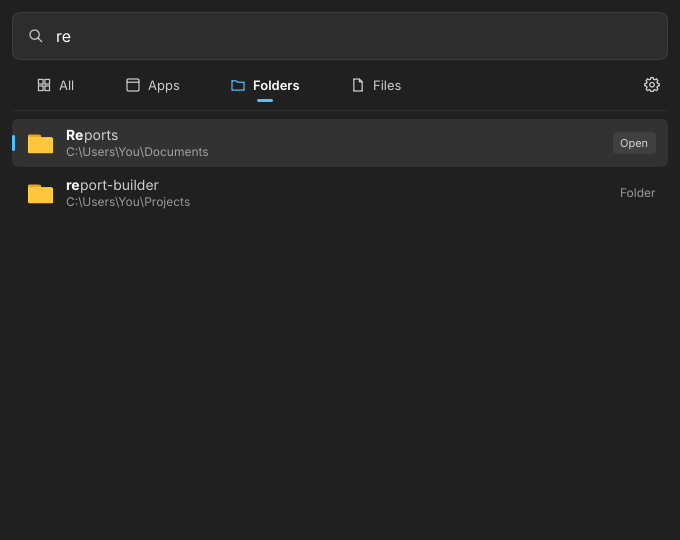
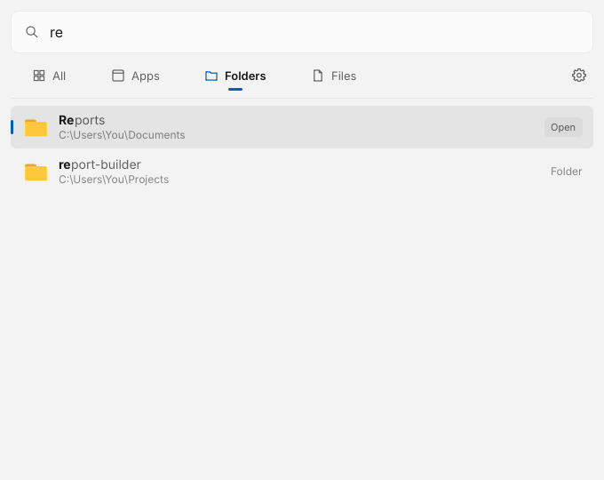
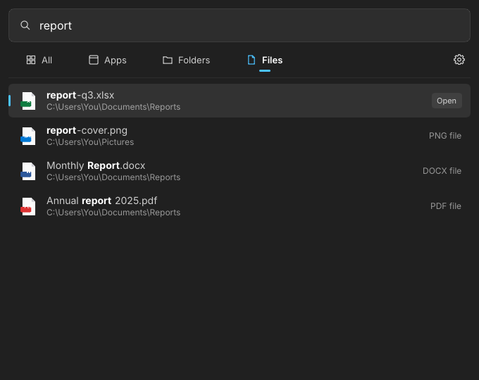
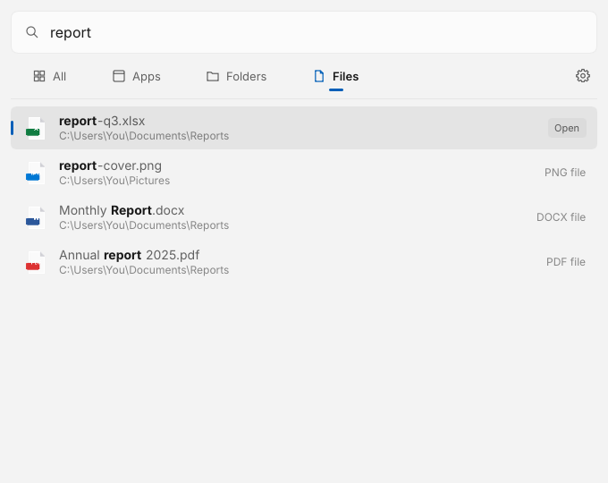
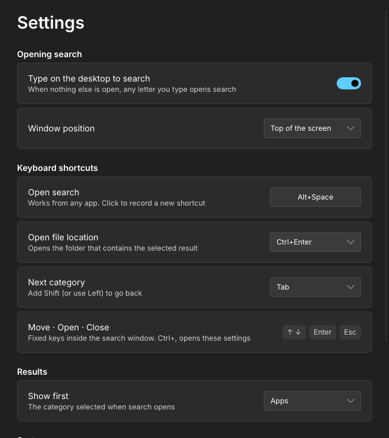
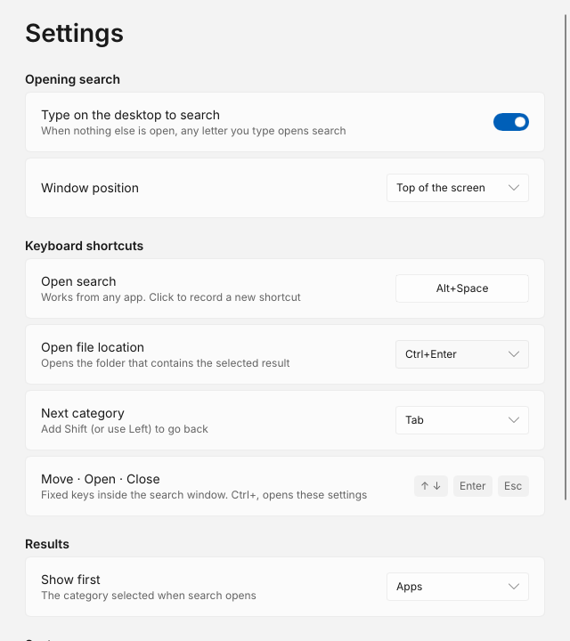

<div align="center">



[](https://github.com/ThisXNeural/Glint/actions/workflows/ci.yml)
[](https://github.com/ThisXNeural/Glint/releases)
[](LICENSE)


**[فارسی](#فارسی)** · **[English](#english)**

</div>

---

<div dir="rtl">

## فارسی

Glint یک جستجوگر سبک و بسیار سریع برای ویندوز است. بی‌صدا در پس‌زمینه می‌ماند و همین که روی دسکتاپ شروع به تایپ کنید باز می‌شود. برنامه‌ها، پوشه‌ها و فایل‌ها را در چند میلی‌ثانیه پیدا می‌کند.

### ویژگی‌ها

- **تایپ روی دسکتاپ:** وقتی پنجرهٔ دیگری باز نیست، با زدن هر حرف جستجو باز می‌شود.
- **میانبر از هر برنامه:** پیش‌فرض <kbd>Alt</kbd>+<kbd>Space</kbd>، قابل تغییر در تنظیمات.
- **سرعت در حد Everything:** نام فایل‌ها مستقیم از جدول MFT در NTFS خوانده می‌شود و با USN Journal به‌روز می‌ماند.
- **دسته‌بندی‌ها:** همه، برنامه‌ها، پوشه‌ها و فایل‌ها. با <kbd>Tab</kbd> بینشان جابه‌جا شوید.
- **رتبه‌بندی هوشمند:** نتایجی که با متن شما شروع می‌شوند اول می‌آیند و بخش منطبق پررنگ می‌شود.
- **ظاهر ویندوز ۱۱:** فونت Segoe UI Variable، افکت Acrylic، و پیروی از حالت روشن/تیره و رنگ اصلی سیستم.
- **مصرف بسیار کم:** نوشته‌شده با Rust، بدون مرورگر داخلی و بدون .NET. در حالت بیکار تقریباً صفر درصد CPU مصرف می‌کند.
- **آیکون واقعی:** آیکون اصلی هر برنامه، پوشه و فایل نمایش داده می‌شود.

### نصب

1. فایل **GlintSetup.exe** را از بخش [Releases](https://github.com/ThisXNeural/Glint/releases) دانلود کنید.
2. هنگام نصب یکی از دو حالت را انتخاب کنید:

| حالت | دسترسی ادمین | محدودهٔ جستجو |
|---|---|---|
| **فقط برای من** (پیشنهادی) | لازم نیست | برنامه‌ها + پوشهٔ کاربری شما |
| **جستجوی کل دیسک** | یک بار هنگام نصب | برنامه‌ها + همهٔ درایوها، به‌صورت زنده |

<p align="center"></p>

### مقایسه

| | **Glint** | Everything | PowerToys Run | Flow Launcher | جستجوی ویندوز |
|---|:---:|:---:|:---:|:---:|:---:|
| متن‌باز | ✅ | ❌ | ✅ | ✅ | ❌ |
| اجرای برنامه‌ها | ✅ | ❌ | ✅ | ✅ | ✅ |
| جستجوی فوری نام فایل از MFT | ✅ | ✅ | ❌ | با افزونهٔ Everything | ❌ |
| باز شدن با تایپ روی دسکتاپ | ✅ | ❌ | ❌ | ❌ | ❌ |
| طراحی ویندوز ۱۱ | ✅ | ❌ | ✅ | با تم | ✅ |
| فناوری | Rust (Native) | Native | .NET | .NET | داخلی ویندوز |

### کلیدها

| کلید | کار |
|---|---|
| <kbd>↑</kbd> <kbd>↓</kbd> | جابه‌جایی بین نتایج |
| <kbd>Enter</kbd> | باز کردن |
| <kbd>Ctrl</kbd>+<kbd>Enter</kbd> | باز کردن محل فایل (قابل تغییر) |
| <kbd>Tab</kbd> | دستهٔ بعدی (قابل تغییر) |
| <kbd>Ctrl</kbd>+<kbd>,</kbd> | تنظیمات |
| <kbd>Esc</kbd> | بستن |

### تصاویر

| تیره | روشن |
|---|---|
|  |  |
|  |  |
|  |  |
|  |  |

### ساخت از سورس

راهنمای ساخت در [بخش انگلیسی](#build-from-source) آمده است.

</div>

---


## English

Glint is a lightweight, very fast search tool for Windows. It sleeps in the background and opens the moment you start typing on the desktop, finding apps, folders and files in milliseconds.

### Features

- **Type on the desktop:** when no other window is focused, any letter opens search.
- **Shortcut from any app:** <kbd>Alt</kbd>+<kbd>Space</kbd> by default, changeable in Settings.
- **Everything-level speed:** file names are read straight from the NTFS master file table and kept live through the USN change journal.
- **Categories:** All, Apps, Folders and Files. <kbd>Tab</kbd> switches between them.
- **Smart ranking:** names that start with what you type come first, and the matched part is highlighted.
- **Windows 11 look:** Segoe UI Variable, acrylic backdrop, follows the system light/dark theme and accent color.
- **Tiny footprint:** native Rust, no embedded browser, no .NET runtime. Near-zero CPU while idle.
- **Real icons** for every app, folder and file.

### Install

1. Download **GlintSetup.exe** from [Releases](https://github.com/ThisXNeural/Glint/releases).
2. Choose how to install:

| Mode | Administrator rights | Searches |
|---|---|---|
| **Just for me** (recommended) | Not needed | Apps + your user folder |
| **Full disk search** | Once, during setup | Apps + every drive, live |

Silent install: `GlintSetup.exe /S` or `GlintSetup.exe /S /MODE=admin`.

### Comparison

| | **Glint** | Everything | PowerToys Run | Flow Launcher | Windows Search |
|---|:---:|:---:|:---:|:---:|:---:|
| Open source | ✅ | ❌ | ✅ | ✅ | ❌ |
| Launches apps | ✅ | ❌ | ✅ | ✅ | ✅ |
| Instant file names from the MFT | ✅ | ✅ | ❌ | With Everything plugin | ❌ |
| Opens by typing on the desktop | ✅ | ❌ | ❌ | ❌ | ❌ |
| Windows 11 design | ✅ | ❌ | ✅ | Via themes | ✅ |
| Built with | Rust (native) | Native | .NET | .NET | Built in |

### Keys

| Key | Action |
|---|---|
| <kbd>↑</kbd> <kbd>↓</kbd> | Move through results |
| <kbd>Enter</kbd> | Open |
| <kbd>Ctrl</kbd>+<kbd>Enter</kbd> | Open file location (configurable) |
| <kbd>Tab</kbd> | Next category (configurable) |
| <kbd>Ctrl</kbd>+<kbd>,</kbd> | Settings |
| <kbd>Esc</kbd> | Close |

### Settings

Everything is in the Settings window (gear icon or <kbd>Ctrl</kbd>+<kbd>,</kbd>). The values are stored in `%APPDATA%\Glint\settings.ini`:

```ini
hotkey=Alt+Space          # e.g. Ctrl+Shift+F, Win+Q
desktop_typing=true       # type on the desktop to open search
position=top              # or center
show_first=apps           # all, apps, folders or files
start_with_windows=true
open_location_key=Ctrl+Enter
category_key=Tab
```

### Build from source

Glint cross-compiles from Linux (this is how CI builds it):

```bash
sudo apt install gcc-mingw-w64-x86-64 nsis libfontconfig1-dev
rustup target add x86_64-pc-windows-gnu
cargo test --workspace
bash installer/build.sh        # -> installer/out/Glint.exe, GlintSetup.exe
```

On Linux, `cargo run -p glint` opens the window with demo data, which is handy for UI work.

| Path | What it is |
|---|---|
| `crates/glint-core` | Search engine: compact name index, ranking, app matcher |
| `crates/glint/src/win` | Windows parts: NTFS/USN index, desktop typing hook, tray, DWM effects |
| `crates/glint/ui/main.slint` | Search and Settings windows |
| `installer/` | NSIS setup with the two install modes |
| `vendor/` | Patched Slint winit backend (0 Hz refresh-rate fix) |

### Code signing

Releases are built by GitHub Actions when a `v*` tag is pushed. If the repository has the secrets `SIGNING_CERT_PFX_BASE64` (the `.pfx` file, base64) and `SIGNING_CERT_PASSWORD`, both executables are signed and timestamped. Without them the release is published unsigned. See [CONTRIBUTING.md](CONTRIBUTING.md#releases-and-signing).

### License

[GPL-3.0](LICENSE). The user interface is built with [Slint](https://slint.dev).
